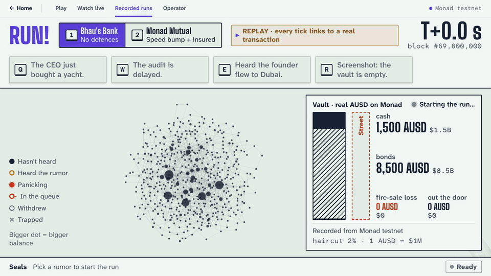
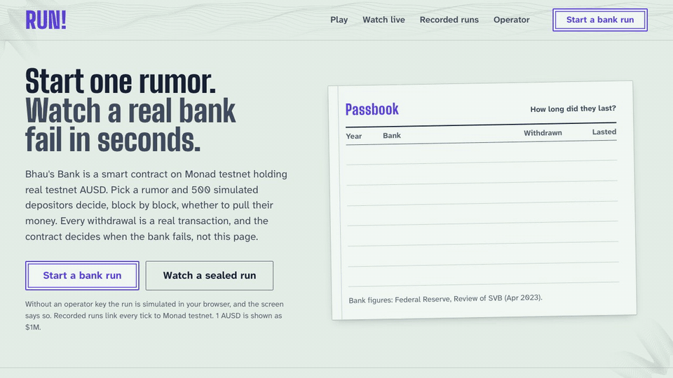
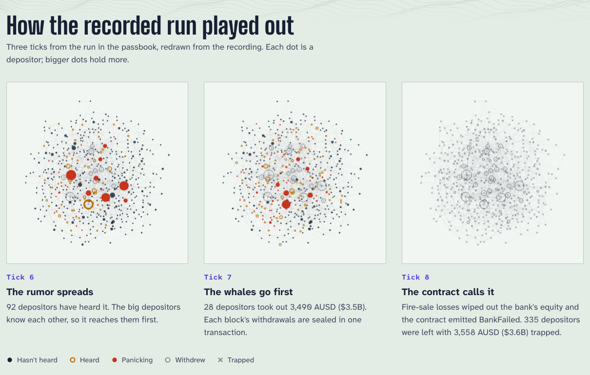

<div align="center">



### A bank run you can watch happen, sealed block by block on Monad.

[](https://run-bank-run.vercel.app)
[](https://testnet.monadvision.com/address/0x2cD82EE2b3C19E996Fa9da80052e912A2E90F41D)
[](#built-at-monad-blitz)
[](#engineered-like-it-holds-real-money)
[](https://testnet.monadvision.com/address/0x2cD82EE2b3C19E996Fa9da80052e912A2E90F41D)

**[Play now](https://run-bank-run.vercel.app/app)** · **[Watch the live bank](https://run-bank-run.vercel.app/watch)** · **[Recorded runs](https://run-bank-run.vercel.app/replay)** · **[The bank on MonadVision](https://testnet.monadvision.com/address/0x2cD82EE2b3C19E996Fa9da80052e912A2E90F41D)**

Designed, built and shipped for and during **Monad Blitz Pune**, in a single day.

</div>

---



<sub>A real run, recorded on Monad testnet and replayed from the chain's own record: Bhau's Bank × "The audit is delayed." The rumor lands, the whales run, cash hits zero, bonds are dumped at a loss, and the contract declares the bank failed: **4.2 seconds, 14 Monad blocks, 335 depositors trapped.**</sub>

## On 9 March 2023, Silicon Valley Bank lost $42 billion in one day. Onchain, a run takes seconds.

**RUN!** is "Plague Inc. for bank runs". You pick a bank, you pick a rumor, you press Enter. The rumor ripples through a network of 500 depositors; the big ones know each other, so they hear first and run first. Withdrawals pour out of the vault, the cash runs dry, the bank starts dumping bonds at a loss, and the moment its losses swallow its equity, a violet rubber stamp slams across the screen: **BANK FAILED.**

None of that is an animation pretending. The bank is a **real smart contract on Monad testnet** holding **10,000 real testnet AUSD**, Agora's stablecoin. Every tick of the run is **sealed in a real transaction**, every withdrawal is a **real token transfer**, every fire-sale loss is **real AUSD gone**, and the verdict is **emitted by the contract, not drawn by the browser**. The stamp waits for Monad.

Then switch to a bank with defences, play the same rumor, and watch it **survive**. Same depositors, same panic, opposite ending. That is the product: a game that teaches people how bank runs work, and a **stress test that tells a protocol whether its withdrawal rules survive a run at block speed.**

## By the numbers

| | |
|---|---|
| **4.2 s** | from rumor to a contract-signed `BankFailed`, measured on testnet |
| **14 blocks** | the whole run, start to verdict, at 400 ms per block |
| **500** | simulated depositors, each deciding every block from public inputs only |
| **10,000 AUSD** | real testnet stablecoin held, paid out and lost by the contract |
| **150+** | withdrawal requests sealed in a single transaction at the peak of the run |
| **0.83 s** | mean time to seal a batch of ticks on testnet |
| **8 / 8 · 25 / 25** | ticks where the screen and the chain agree, failing and surviving runs |
| **344** | automated tests: 52 Foundry (unit, invariant, fork, golden vectors) and 292 Vitest |
| **2** | contracts with verified source on MonadVision (Sourcify exact match) and Monadscan |

## What makes RUN! different

- **The bank is the contract.** `RunBank` holds the ledger of 500 balances, cash, bonds, a FIFO withdrawal queue and deposit insurance. It pays withdrawals, prices every fire sale on a haircut curve that steepens the harder it dumps, and declares insolvency the instant losses exceed equity. The browser only proposes who wants out; the chain decides what happens.
- **Every block is a chapter.** One transaction per block carries that block's withdrawals (up to eight ticks merged when the network is busy), sent with `eth_sendRawTransactionSync` so the receipt comes back in the same round trip. Watch the ticker fill with block numbers, transaction links and ✓ finalized marks while the run plays.
- **The stamp waits for Monad.** When the model predicts failure, the screen freezes on "Sealing the verdict…" and only stamps when the `BankFailed` event is sealed onchain. Monad decides when the bank fails. Not the screen.
- **Screen and chain agree, provably.** A TypeScript mirror of the contract's bank maths is checked against every `TickSealed` event, and the proof panel shows it: `8 / 8 ticks: screen and chain agree ✓`. Ten shared golden-vector scenarios keep the Solidity and the TypeScript identical to the base unit.
- **Simulated depositors, provable decisions.** The depositors are an open, deterministic model: a public network, public balances, a public rumor, integer hashing instead of randomness. Anyone can recompute every single decision from chain history; the app does it after every sealed run and shows that every tick's decisions match the public model (`8 of 8`).
- **Four ways in.** Play it yourself, follow the live bank rebuilt **from chain data alone**, replay recorded runs with a transaction link for every batch, or run the operator desk with a full preflight.

## Why it has to be Monad

A bank run is a race, and on most chains the race is too slow to watch. At 12 seconds a block, the same run takes minutes and the drama evaporates. On Monad, **a whole run fits in about a dozen 400 ms blocks with 800 ms finality**, so a room full of people can watch a bank die block by block, and every block is final 800 ms after it lands.

RUN! is built for Monad's specifics, not ported to them:

- **400 ms ticks.** The simulation steps at block speed, and the sealing pipeline keeps exactly one transaction in flight so ticks land in order, gap-free.
- **Synchronous receipts.** `eth_sendRawTransactionSync` returns the receipt with the send, which is what makes a tick-per-block cadence practical from a browser.
- **Gas is charged on the limit.** Monad bills the gas limit, not gas used, so RUN! ships a gas model calibrated from 108 real samples: tight enough not to waste MON, above every measured batch, with an automatic retry if a limit ever falls short.
- **Expensive cold reads.** Storage is packed for Monad's 8,100-gas cold `SLOAD`: the 500-depositor ledger fits 8 balances per slot, bank state lives in two slots, the queue is a ring buffer.
- **The 10 MON reserve.** Preflight and the send path guard Monad's reserve-balance rule, with a one-click switch to a backup operator key.

## How a tick gets sealed



```text
 Browser (Vite + React)                                           Monad testnet
 ┌──────────────────────────────────────────────────────┐        ┌──────────────────────────┐
 │ engine/  500 depositors · panic model · bank mirror   │        │ RunBank.sol               │
 │    │ every 400 ms: who wants out                      │        │  ledger · cash · bonds    │
 │    ▼                                                  │  1 tx  │  queue · insurance        │
 │ chain/   SealQueue (1 tx in flight, ≤ 8 ticks/tx) ────┼──────► │  fire sales · verdict     │
 │          RPC failover · gas model · preflight         │◄────── │  TickSealed · BankFailed  │
 │    ▲     spectator · recorder                         │ events │        │ AUSD             │
 │    │ mirror check per tick                            │        │        ▼                  │
 │ ui/      stage · vault · ticker · stamp · proof panel │        │ Street.sol (exits go here)│
 └──────────────────────────────────────────────────────┘        └──────────────────────────┘
```

## Two banks. One rumor. Opposite endings.

| | **Bhau's Bank** | **Monad Mutual** |
|---|---|---|
| Defences | None | Speed bump: pays at most 3% of deposits per block · insures the first 50 AUSD per depositor |
| Balance sheet | 1,500 AUSD cash · 8,500 AUSD bonds · 500 AUSD equity | Identical |
| Rumor "The audit is delayed." | **Fails at tick 8**: 4.2 s, 14 blocks, 335 trapped | **Survives at tick 25**: a queue forms, insured depositors mostly stay calm, 0 trapped |

The speed bump is not invented for the game. In September 2019 the Reserve Bank of India capped withdrawals at PMC Bank at ₹1,000 per account; real people lost access to their savings. RUN! lets you see, in seconds, what rules like that do to a run.

## The history of bank runs, printed



<sub>The home page prints the great bank runs on a dot-matrix passbook, then the last line: a run recorded on Monad testnet, computed from the recording itself, never typed in. Washington Mutual lasted 16 days. Wachovia, 8. SVB, 1. Bhau's Bank, 4.2 seconds.</sub>

## Every decision, out in the open



Each dot is a depositor; bigger dots hold more. The rumor spreads along real links, the whales run first because they hear first, and when the contract calls it, everyone still inside is trapped. These frames are recomputed from the recorded run with the same engine the app uses, so they are exactly what happened onchain.

## Engineered like it holds real money

- **Contract:** 52 Foundry tests, including the worked example to the base unit, invariants (AUSD conserved between bank and street, nobody paid twice, `cash + bonds + losses + paid == starting assets`), and fork tests against the real testnet AUSD.
- **Mirror:** 10 golden-vector scenarios replayed field by field in both Solidity and TypeScript, covering failure mid-payout, queue overshoot, capped haircuts and survival after quiet blocks.
- **Determinism:** no `Math.random`, no transcendental maths in the step function, a pinned snapshot of every request history. Same inputs, same run, in every browser. 0.03 ms per step.
- **Reliability:** RPC failover across three public endpoints, a dedicated-URL slot, timeouts on every call, same-hash re-broadcast for slow transactions, tick-mismatch recovery, a backup operator key, and a single-writer lock so no two operator scripts ever write to the bank at once.
- **Fallbacks:** if the network dies, `Shift+R` plays a recorded real run with every link intact. Nothing on screen ever pretends: a mode chip always says whether you are live, practising, replaying or spectating.
- **Craft:** a 60 fps canvas of 500 depositors, a violet rubber-stamp signature that only lands on a sealed verdict, synthesised sound, full keyboard control, reduced-motion support, and layouts that hold from a phone to a projector.

## Built at Monad Blitz

RUN! went from a blank folder to a deployed, verified, tested product during **Monad Blitz Pune**. In one day:

- a bank contract with fire sales, a withdrawal queue, deposit insurance and onchain insolvency, deployed, funded with real AUSD and **verified**;
- a deterministic 500-depositor contagion model, tuned so the defended bank survives the same rumor that kills the undefended one;
- a sealing pipeline that turns a browser into a block-speed transaction engine on Monad;
- a projector-grade stage, a landing page, live spectating, recorded replays and an operator desk, **live on Vercel**.

The contracts, engine, chain layer, stage, brand and platform were built in parallel against frozen interfaces, with golden vectors keeping the Solidity and the TypeScript in lockstep the whole way.

## Where RUN! goes next

RUN! is a game today. The engine underneath is a **run-test harness**, and that is where it is headed.

1. **Plug in your protocol.** Any vault, lending pool, LST redemption queue or stablecoin redeemer that answers four calls (`deposit`, `requestWithdraw`, `processWithdrawals`, `solvency`) can be run through the same rumor. The interface is already sketched in [`contracts/src/IRunTarget.sol`](contracts/src/IRunTarget.sol).
2. **Run-tests in CI.** Every change to a protocol's exit rules gets a time-to-failure, trapped-value and loss report under a library of modelled runs, before it ships, at block speed.
3. **Scenario studio.** Design your own bank (cash, assets, haircut curve, speed bump, insurance) and your own rumor; share the run as a link anyone can replay and verify.
4. **Live run radar.** Point the model at real withdrawal queues and redemption flows on Monad and score how close a protocol is to a run, in real time.
5. **Multiplayer rumors.** A room full of phones becomes the depositors: start a rumor, see who holds their nerve.
6. **A classroom edition.** Financial literacy that people remember: SVB, Northern Rock and PMC Bank as playable scenarios, in English, Hindi and Marathi.
7. **Full history.** An indexed archive of every run ever sealed, with shareable run cards and a leaderboard of the defences that hold.

## Try it

| | |
|---|---|
| [`/`](https://run-bank-run.vercel.app) | The landing page: the passbook, the four ways in, every recording, the contracts |
| [`/app`](https://run-bank-run.vercel.app/app) | The stage. Practice in your browser, or live on testnet with an operator key |
| [`/watch`](https://run-bank-run.vercel.app/watch) | The live bank, rebuilt from chain data alone |
| [`/replay`](https://run-bank-run.vercel.app/replay) | Recorded runs, every batch linked to its transaction |
| [`/ops`](https://run-bank-run.vercel.app/ops) | Operator desk: keys, preflight, funding, reset |

On the stage: `1` / `2` pick the bank, `Q W E R` pick the rumor, `Enter` starts the run, `P` opens the proof, `C` the passbook, `X` resets, `F` goes full screen, `H` shows every key.

## The bank onchain (Monad testnet, chain 10143)

| Contract | Address |
|---|---|
| `RunBank` | [`0x2cD82EE2b3C19E996Fa9da80052e912A2E90F41D`](https://testnet.monadvision.com/address/0x2cD82EE2b3C19E996Fa9da80052e912A2E90F41D) |
| `Street` (where exits go) | [`0x7998f16710Ab81AD2D68d7C0B7F0fd296CC7927D`](https://testnet.monadvision.com/address/0x7998f16710Ab81AD2D68d7C0B7F0fd296CC7927D) |
| AUSD (Agora, 6 decimals) | [`0xa9012a055bd4e0eDfF8Ce09f960291C09D5322dC`](https://testnet.monadvision.com/address/0xa9012a055bd4e0eDfF8Ce09f960291C09D5322dC) |

Source verified on MonadVision (Sourcify exact match) and Monadscan.

## Run it yourself

```bash
cd app
pnpm install
cp .env.example .env.local   # optional: testnet-only operator keys for Live mode
pnpm dev                     # http://localhost:5173 · the stage is /app
pnpm test                    # engine, chain, controller and UI tests
cd ../contracts && forge test
```

Without keys everything runs in Practice mode, clearly labelled. Testnet only; display scale 1 AUSD = $1M, always labelled; all banks are fictional.

<details>
<summary><b>Stack and repository layout</b></summary>

- **Contracts** (`contracts/`): Solidity 0.8.28, Foundry, OpenZeppelin. `RunBank`, `Street`, a `MockAUSD` fallback, deploy, fund and verify scripts.
- **Engine** (`app/src/engine/`): pure TypeScript. Barabási–Albert depositor network, skewed ledger, panic model, bank-maths mirror, tuner, golden vectors.
- **Chain** (`app/src/chain/`): viem. Failover clients, operator keys, live and mock adapters, SealQueue, preflight, plain-language errors, spectator, recorder.
- **App** (`app/src/app/`): store, a single run controller for Live, Practice, Replay and Spectate, routes, hotkeys.
- **UI** (`app/src/ui/`): the landing page and nav, the stage (Canvas 2D network, vault, ticker, passbook), the brand kit (stamp, sound, type) and the panels (proof, ops, replays).
- **README media**: the animated banner and pipeline are generated by [`docs/readme/generate.py`](docs/readme/generate.py); the GIFs and frames are recorded from the app itself.

Vite + React, zustand, wouter, motion, self-hosted Big Shoulders Display, Atkinson Hyperlegible Next and Mono, Doto and Tiro Devanagari Marathi. Deployed on Vercel as a static build; no keys ever leave the presenter's browser.

</details>

## Sources

Historical figures come from the Federal Reserve's *Review of the Federal Reserve's Supervision and Regulation of Silicon Valley Bank* (April 2023) and Material Loss Review (September 2023), and RBI press releases on PMC Bank (September 2019). PMC Bank is a real event in which real people lost access to their savings; RUN! cites it as the real-world version of a withdrawal speed bump. Every bank in the game is fictional, and testnet AUSD has no market value.

<div align="center">
<br>
<b>RUN!</b> · built for and during Monad Blitz Pune · sealed on Monad
</div>
