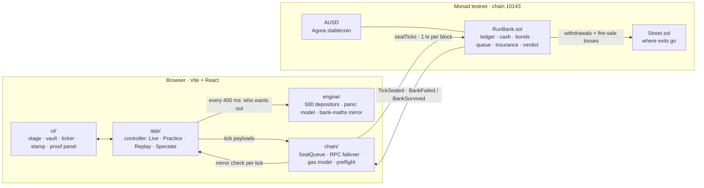

<div align="center">


### A bank run you can watch happen, sealed block by block on Monad.

[](https://run-bank-run.vercel.app)
[](https://testnet.monadvision.com/address/0x2cD82EE2b3C19E996Fa9da80052e912A2E90F41D)
[](#built-at-monad-blitz)
[](#engineering)
[](#contracts-monad-testnet)

**[Play now](https://run-bank-run.vercel.app/app)** · **[Watch the live bank](https://run-bank-run.vercel.app/watch)** · **[Recorded runs](https://run-bank-run.vercel.app/replay)**

Built for and during **Monad Blitz Pune**, in a single day.

</div>

## What it is

- **"Plague Inc. for bank runs."** Pick a bank, pick a rumor, press Enter: 500 depositors panic, the vault drains, and a violet stamp slams down: **BANK FAILED**.
- **The bank is real.** A smart contract on Monad testnet holding **10,000 real testnet AUSD**. Every withdrawal is a real transfer; every fire-sale loss is real AUSD gone.
- **Every tick is sealed onchain.** One transaction per 400 ms block; the contract, not the browser, declares the bank failed.
- **Defences change the ending.** Same rumor on a bank with a withdrawal speed bump and deposit insurance: it survives.
- **A game today, a stress test tomorrow.** Plug in any protocol's withdrawal rules and see if they survive a run at block speed.

## By the numbers

- **4.2 s** from rumor to a contract-signed `BankFailed`, over **14 Monad blocks**
- **500** depositors deciding every block, **150+** withdrawal requests sealed in one transaction at the peak
- **0.83 s** mean time to seal a batch on testnet
- **8 / 8** and **25 / 25** ticks where screen and chain agree (failing and surviving runs)
- **344** automated tests: 52 Foundry, 292 Vitest
- **2** contracts with verified source (MonadVision Sourcify exact match, Monadscan)

## Why Monad

- **400 ms blocks, 800 ms finality**: a whole run fits in about a dozen blocks, so you can watch it. On a 12 s chain it takes minutes.
- **`eth_sendRawTransactionSync`**: receipts return with the send, making one tick per block practical from a browser.
- **Gas charged on the limit**: a gas model calibrated from 108 real samples keeps limits tight and above every measured batch.
- **Expensive cold reads**: storage packed 8 balances per slot, bank state in two slots, a ring-buffer queue.
- **10 MON reserve rule**: guarded in preflight and the send path, with a one-click backup operator key.

## Architecture



- **Contract decides.** `RunBank` pays withdrawals, prices fire sales on a steepening haircut curve, and declares insolvency when losses exceed equity.
- **Browser proposes.** The engine picks who wants out each tick; the SealQueue keeps one transaction in flight and merges up to 8 ticks when the network is busy.
- **Screen = chain.** A TypeScript mirror of the bank maths is checked against every `TickSealed` event; 10 golden-vector scenarios keep Solidity and TypeScript identical.
- **The stamp waits for Monad.** The verdict only appears once the `BankFailed` / `BankSurvived` event is sealed.

## Two banks, one rumor

- **Bhau's Bank** (no defences): fails at tick 8, 4.2 s, 14 blocks, 335 depositors trapped.
- **Monad Mutual** (pays at most 3% of deposits per block, insures the first 50 AUSD): survives at tick 25, 0 trapped.
- Same balance sheet for both: 1,500 AUSD cash, 8,500 AUSD bonds, 500 AUSD equity.

## Engineering

- **Contract**: 52 Foundry tests, including invariants (AUSD conserved, nobody paid twice) and fork tests against real testnet AUSD.
- **Deterministic depositors**: an open model with no randomness; anyone can recompute every decision from chain history, and the app checks it after every sealed run.
- **Reliable sealing**: RPC failover across three endpoints, same-hash re-broadcast, tick-mismatch recovery, backup key.
- **Honest modes**: a chip always says Live, Practice, Replay or Spectate; `Shift+R` plays a recorded real run if the network dies.
- **Craft**: 60 fps canvas, synthesised sound, full keyboard control, reduced-motion support, phone to projector.

## Built at Monad Blitz

- From an empty folder to a deployed, verified, tested product in one day at **Monad Blitz Pune**.
- Contracts, engine, chain layer, stage, brand and platform built in parallel against frozen interfaces.
- Live on Vercel with a landing page, live spectating, recorded replays and an operator desk.

## Roadmap

- **Plug in your protocol**: vaults, lending pools, LST queues and stablecoin redeemers via a four-call interface ([`IRunTarget.sol`](contracts/src/IRunTarget.sol)).
- **Run-tests in CI**: time-to-failure and trapped-value reports for every change to a protocol's exit rules.
- **Scenario studio**: design your own bank and rumor; share runs anyone can replay and verify.
- **Live run radar**: score real withdrawal queues on Monad for run risk in real time.
- **Multiplayer rumors**: a room full of phones becomes the depositors.
- **Classroom edition**: SVB, Northern Rock and PMC Bank as playable scenarios, in English, Hindi and Marathi.

## Try it

- [`/`](https://run-bank-run.vercel.app): landing page with links to everything
- [`/app`](https://run-bank-run.vercel.app/app): the stage (Practice in your browser, Live with an operator key)
- [`/watch`](https://run-bank-run.vercel.app/watch): the live bank, rebuilt from chain data alone
- [`/replay`](https://run-bank-run.vercel.app/replay): recorded runs, every batch linked to its transaction
- Keys: `1`/`2` bank · `Q W E R` rumor · `Enter` start · `P` proof · `C` passbook · `X` reset · `F` full screen · `H` help

## Contracts (Monad testnet)

- `RunBank`: [`0x2cD82EE2b3C19E996Fa9da80052e912A2E90F41D`](https://testnet.monadvision.com/address/0x2cD82EE2b3C19E996Fa9da80052e912A2E90F41D)
- `Street`: [`0x7998f16710Ab81AD2D68d7C0B7F0fd296CC7927D`](https://testnet.monadvision.com/address/0x7998f16710Ab81AD2D68d7C0B7F0fd296CC7927D)
- AUSD: [`0xa9012a055bd4e0eDfF8Ce09f960291C09D5322dC`](https://testnet.monadvision.com/address/0xa9012a055bd4e0eDfF8Ce09f960291C09D5322dC)

## Run locally

```bash
cd app && pnpm install && pnpm dev     # http://localhost:5173 · stage at /app
pnpm test                              # engine, chain, controller, UI
cd ../contracts && forge test
```

- Stack: Solidity 0.8.28 + Foundry · Vite + React · viem · zustand · Vercel.
- Testnet only. Display scale 1 AUSD = $1M. All banks are fictional.
- Sources: Federal Reserve reviews of SVB (2023); RBI press releases on PMC Bank (2019).
